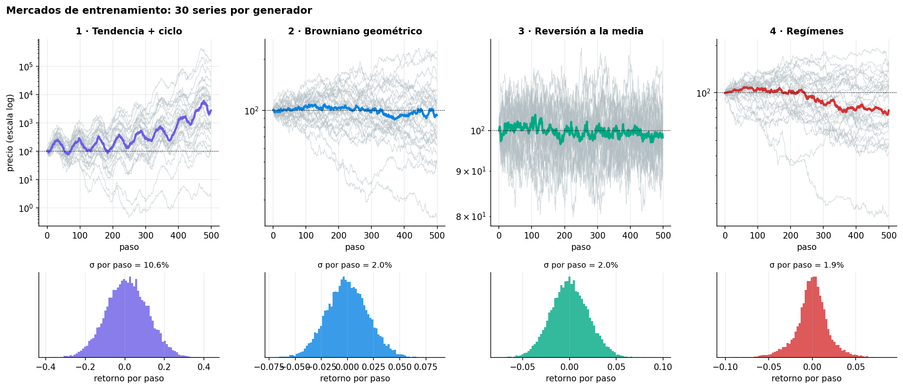
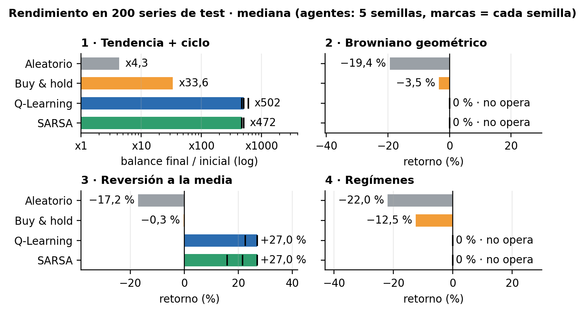
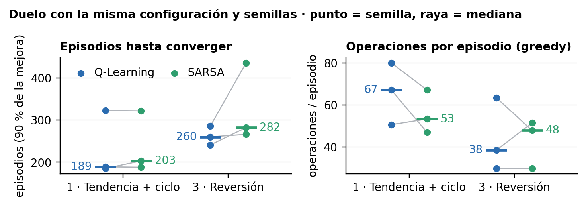
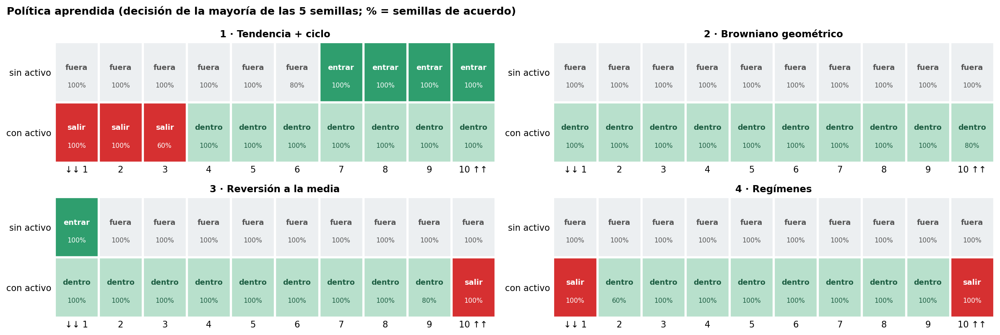
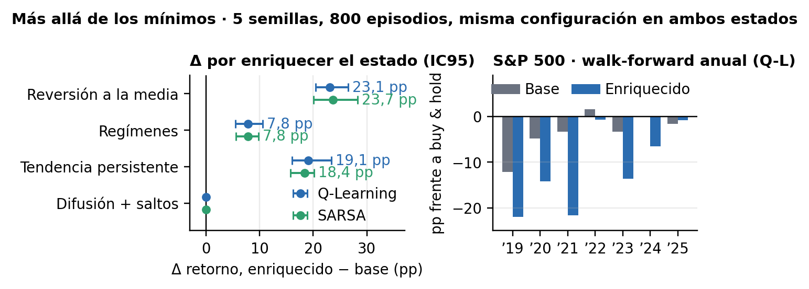

<div align="center">

# RL Trading Agents

**Q-Learning y SARSA tabulares para invertir en un único activo sobre cuatro mercados sintéticos y el S&P 500**


Máster MIAX · Aprendizaje por Refuerzo · Taller 1 · Octubre 2026<br>
Óscar Romero Quincoces · Fernando Dapena Tauste · Daniel García López

[**Informe PDF**](results/informe.pdf) · [**Presentación**](presentacion/presentacion.pdf) · [**Comparativa final**](notebooks/04_comparativa.ipynb) · [Decisiones](docs/DECISIONES.md) · [Taller 2 (deep RL)](https://github.com/Romequinco/deep-rl-trading-agents)

</div>

---

## En una frase

> Con el estado del enunciado (`tendencia`, `posición`), **Q-Learning y SARSA aprenden la estrategia esperada en
> cada mercado**: siguen la tendencia donde la hay (**x502** frente a x33,6 de buy & hold), compran caídas en
> reversión a la media y **no operan donde no hay señal**, que es lo correcto. Lo que más cambia el resultado no es
> el algoritmo, sino la tasa de aprendizaje y la información que entra en el estado.

<p align="center"></p>
<p align="center"><sub>Los cuatro mercados del taller: tendencia + ciclo, browniano geométrico, reversión a la media y regímenes alcista/bajista.</sub></p>

## Resultados de un vistazo

Mediana del retorno en las **200 series de test**. Para los agentes es la mediana de 5 semillas, con hiperparámetros
ajustados en validación (D-0.4, D-2.3).

| Mercado | Aleatorio | Buy & hold | **Q-Learning** | **SARSA** | Estrategia aprendida (las dos coinciden) |
|---|---|---|---|---|---|
| 1 · Tendencia + ciclo | x4,3 | x33,6 | **x502** | **x472** | Sigue la tendencia (entra en bins altos, sale en 1–3) |
| 2 · Browniano | −19,4 % | −3,5 % | **0 %** | **0 %** | No opera (correcto: no hay señal) |
| 3 · Reversión a la media | −17,2 % | −0,3 % | **+27,0 %** | **+27,0 %** | Compra tras la caída más fuerte y vende tras la subida más fuerte |
| 4 · Regímenes | −22,0 % | −12,5 % | **0 %** | **0 %** | No opera: es lo óptimo con este estado (D-2.4) |

<table>
<tr>
<td width="50%"><br><sub><b>Rendimiento.</b> Los dos tabulares baten al aleatorio y a buy & hold donde hay señal, y se quedan fuera donde no la hay.</sub></td>
<td width="50%"><br><sub><b>Convergencia.</b> Q-Learning converge algo antes que SARSA (189 frente a 203 episodios en el mercado 1).</sub></td>
</tr>
<tr>
<td width="50%"><br><sub><b>Política aprendida.</b> Qué hace el agente en cada estado de tendencia y posición, mercado a mercado.</sub></td>
<td width="50%"><br><sub><b>Más allá de los mínimos.</b> El estado enriquecido ayuda en tres mercados; en el S&P 500 no bate a buy & hold.</sub></td>
</tr>
</table>

**Claves**

- α = 0,001 en todos los mercados; con 0,1 el agente no aprende (D-2.2).
- γ depende del mercado: 0 en el 1 y 0,5 en el 3.
- Q-Learning converge en ≈ 100–260 episodios; SARSA, algo más despacio (≈ 200–360).
- SARSA es más conservador mientras explora, pero la diferencia es pequeña porque un error cuesta solo un 0,1 % y ε
  decae a 0,01.
- En el mercado 4, ninguna de las 70 reglas simples sobre el estado bate a no operar: el límite está en el estado, no
  en el algoritmo.

## Cómo está organizado

| Notebook | Qué hace |
|---|---|
| [`00_entorno_y_baselines`](notebooks/00_entorno_y_baselines.ipynb) | Entorno, los cuatro mercados, referencias (aleatorio y buy & hold) y decisiones comunes |
| [`01_qlearning`](notebooks/01_qlearning.ipynb) | Q-Learning: ajuste por etapas de α, ε, γ y episodios, test y política aprendida |
| [`02_sarsa`](notebooks/02_sarsa.ipynb) | SARSA con el mismo protocolo y duelo con Q-Learning |
| [`03_extras`](notebooks/03_extras.ipynb) | Estado enriquecido, dos mercados extra, serie real del S&P 500 y anexo de robustez |
| [`04_comparativa`](notebooks/04_comparativa.ipynb) | Solo lee `results/`: tabla final, convergencia y análisis crítico |

## Más allá de los mínimos (`03_extras`)

### Base frente a estado enriquecido

El estado enriquecido añade **distancia a MA30 y volatilidad a 20 sesiones** al estado base. Mismos hiperparámetros,
800 episodios, cinco semillas y las mismas historias de test; **Δ = enriquecido − base**, en puntos porcentuales.

| Mercado | Algoritmo | Base | Enriquecido | Δ retorno (pp) |
|---|---|---:|---:|---:|
| Reversión a la media | Q-Learning | +18,1 % | +42,8 % | +24,6 |
| Reversión a la media | SARSA | +18,1 % | +43,8 % | +25,6 |
| Regímenes | Q-Learning | +0,0 % | +7,8 % | +7,8 |
| Regímenes | SARSA | +0,0 % | +7,5 % | +7,5 |
| Tendencia persistente | Q-Learning | +104,5 % | +123,8 % | +19,3 |
| Tendencia persistente | SARSA | +103,0 % | +128,7 % | +25,7 |
| Difusión + saltos | Q-Learning | +0,0 % | +0,0 % | +0,0 |
| Difusión + saltos | SARSA | +0,0 % | +0,0 % | +0,0 |
| S&P 500 · real | Q-Learning | +45,9 % | +28,3 % | −17,5 |
| S&P 500 · real | SARSA | +45,9 % | +29,9 % | −16,0 |

Mejora en reversión, regímenes y tendencia persistente. En el S&P 500 baja el retorno, pero también la caída máxima
(de 18,9 % a 11,4 % con Q-Learning). La serie real es un único recorrido de test de 2024–2025. Detalle en
[`results/03_base_vs_enriquecido.md`](results/03_base_vs_enriquecido.md).

### Pruebas de robustez

360 entrenamientos que cambian un solo factor cada vez (Q-Learning con el estado enriquecido como referencia):

| Pregunta | Resultado |
|---|---|
| ¿Qué indicador aporta? | Uno por mercado: MA30 en reversión y en tendencia persistente; volatilidad en regímenes |
| ¿Falta entrenamiento? | No: con ×4 episodios el S&P 500 pasa de +28,3 % a +28,7 % |
| Placebos | Browniano: no opera. S&P 500 barajado (mismo buy & hold, +44,2 %): base +44,0 %, enriquecido +11,1 % |
| Comisión 0–0,5 % | Opera menos al subir el coste; reversión conserva +23 % y tendencia +80 % con 0,5 % |
| Expected SARSA y Double Q | Los cuatro algoritmos quedan dentro del rango entre semillas |
| Recompensa log(balance) | Sin cambios relevantes |
| Walk-forward S&P 500 2019–2025 | Ningún estado bate de forma consistente a buy & hold; el enriquecido reduce la caída máxima en 4 de 7 años |

Conclusiones completas en [`results/03_anexo_conclusiones.md`](results/03_anexo_conclusiones.md) y decisión D-1.4.

<details>
<summary><b>Enunciado (resumen)</b></summary>

- **Entorno:** `SimpleTradingEnv` del taller. El estado es `(tendencia, posición)`, las acciones son
  vender / mantener / comprar, la comisión es del 0,1 % y la recompensa es la variación del precio
  con posición abierta menos los costes.
- **Mínimos:**
  1. Q-Learning y SARSA en los 4 mercados, con una serie nueva en cada episodio y evaluación
     promediada sobre series de test.
  2. Comparación con el aleatorio y con buy & hold, razonando si la estrategia es la esperada.
  3. Ajuste de α, ε (con decaimiento), γ y número de episodios.
  4. Tabla comparativa de rendimiento y tiempo de convergencia.
- **Entrega:** PDF de 2 páginas como máximo y presentación de 15 minutos en clase.

</details>

## Estructura

```
├── notebooks/                 # 00–04, se leen en GitHub ya ejecutados
├── src/                       # código común: única fuente de verdad
│   ├── env.py                 # SimpleTradingEnv (copia del taller) + discretize()
│   ├── markets.py             # 4 generadores del taller (+ extras) y make_prices(market, n, seed)
│   ├── agents.py              # RandomAgent, BuyHoldAgent, QLearningAgent, SarsaAgent
│   ├── experiment.py          # train(), evaluate(), summarize(), save_results(), gráficas
│   ├── extras.py              # variantes del 03 (no tocan el código base)
│   └── extras_anexo.py        # pruebas de robustez del 03
├── tests/                     # unittest
├── docs/
│   ├── DECISIONES.md          # registro de decisiones D-X.n
│   └── teoria/                # síntesis del material de clase, con la fuente citada
├── data/                      # S&P 500 de FRED con procedencia y huella
├── results/                   # CSV por notebook, figuras, informe.md → informe.pdf
└── presentacion/              # presentación en PDF y sus figuras
```

## Puesta en marcha

En Windows (PowerShell), desde la carpeta del proyecto:

```powershell
py -3.13 -m venv .venv
.\.venv\Scripts\python.exe -m pip install -r requirements.txt
.\.venv\Scripts\python.exe -m ipykernel install --user --name rl-trading-agents --display-name "Python (RL Trading)"
.\.venv\Scripts\python.exe -m jupyterlab notebooks/
```

En otros sistemas:

```bash
pip install -r requirements.txt
jupyter lab notebooks/
```

- Los barridos de hiperparámetros usan `run_grid()` (en paralelo y con caché: reabrir un notebook no reentrena).
  Para forzarlo, `RECALCULAR = True` en la celda de setup.
- Pruebas desde la raíz: `python -m unittest discover -s tests -v`.
- El informe se regenera con `python build_informe.py`.

## Licencia

MIT.
