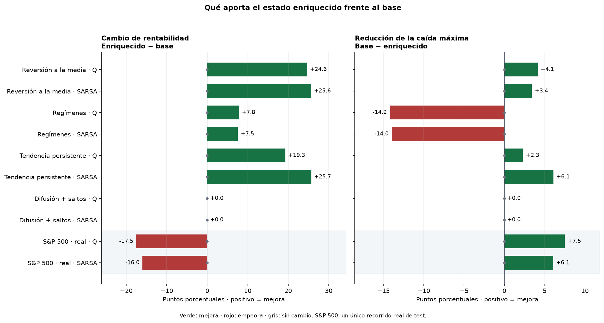

# Comparación directa: modelos base y estado enriquecido

Resultados del experimento 03: 5 semillas, 800 episodios por entrenamiento y 200 historias sintéticas de test; un único recorrido real de 2024–2025.

Base: tendencia corta y posición (20 estados). Enriquecido: añade distancia MA30 y volatilidad20 (hasta 180 estados). Mismos hiperparámetros, presupuesto e historias de test para ambas variantes. Los modelos ajustados de 01–02 no son el control de esta comparación.

## Rentabilidad

| Mercado | Algoritmo | Base | Enriquecido | Δ retorno (pp) |
|---|---|---:|---:|---:|
| Reversión a la media | Q-Learning | +18.1% | +42.8% | +24.6 |
| Reversión a la media | SARSA | +18.1% | +43.8% | +25.6 |
| Regímenes | Q-Learning | +0.0% | +7.8% | +7.8 |
| Regímenes | SARSA | +0.0% | +7.5% | +7.5 |
| Tendencia persistente | Q-Learning | +104.5% | +123.8% | +19.3 |
| Tendencia persistente | SARSA | +103.0% | +128.7% | +25.7 |
| Difusión + saltos | Q-Learning | +0.0% | +0.0% | +0.0 |
| Difusión + saltos | SARSA | +0.0% | +0.0% | +0.0 |
| S&P 500 · real | Q-Learning | +45.9% | +28.3% | -17.5 |
| S&P 500 · real | SARSA | +45.9% | +29.9% | -16.0 |

## Caída máxima (drawdown)

| Mercado | Algoritmo | Base | Enriquecido | Reducción drawdown (pp) |
|---|---|---:|---:|---:|
| Reversión a la media | Q-Learning | 22.2% | 18.1% | +4.1 |
| Reversión a la media | SARSA | 21.7% | 18.3% | +3.4 |
| Regímenes | Q-Learning | 0.0% | 14.2% | -14.2 |
| Regímenes | SARSA | 0.0% | 14.0% | -14.0 |
| Tendencia persistente | Q-Learning | 14.2% | 11.8% | +2.3 |
| Tendencia persistente | SARSA | 17.2% | 11.1% | +6.1 |
| Difusión + saltos | Q-Learning | 0.0% | 0.0% | +0.0 |
| Difusión + saltos | SARSA | 0.0% | 0.0% | +0.0 |
| S&P 500 · real | Q-Learning | 18.9% | 11.4% | +7.5 |
| S&P 500 · real | SARSA | 18.9% | 12.8% | +6.1 |

## Lectura de los resultados

- **Reversión a la media · Q-Learning:** más retorno y menor drawdown.
- **Reversión a la media · SARSA:** más retorno y menor drawdown.
- **Regímenes · Q-Learning:** más retorno y mayor drawdown.
- **Regímenes · SARSA:** más retorno y mayor drawdown.
- **Tendencia persistente · Q-Learning:** más retorno y menor drawdown.
- **Tendencia persistente · SARSA:** más retorno y menor drawdown.
- **Difusión + saltos · Q-Learning:** el mismo retorno y el mismo drawdown.
- **Difusión + saltos · SARSA:** el mismo retorno y el mismo drawdown.
- **S&P 500 · real · Q-Learning:** menos retorno y menor drawdown.
- **S&P 500 · real · SARSA:** menos retorno y menor drawdown.

Las diferencias son restas de los resúmenes, expresadas en puntos porcentuales: Δ retorno = enriquecido − base; reducción del drawdown = base − enriquecido. En ambas columnas, positivo indica mejora. No son las medianas de diferencias emparejadas ni los intervalos bootstrap de `03_estado_deltas.csv`.

El retorno toma primero la mediana entre historias de cada entrenamiento y después la mediana entre semillas. El drawdown toma la media entre historias de cada entrenamiento y después la mediana entre semillas. En la serie real solo hay una historia por política: cinco semillas no equivalen a cinco mercados independientes. Más indicadores no garantizan más rentabilidad; ambos se incorporan conjuntamente y no se mide su contribución individual.

