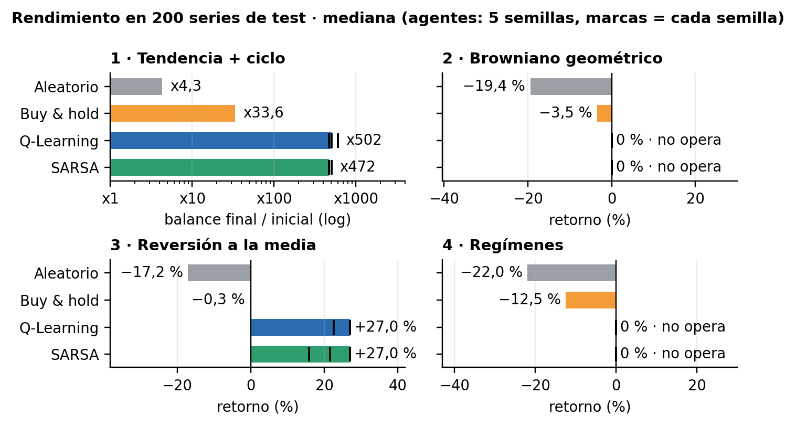
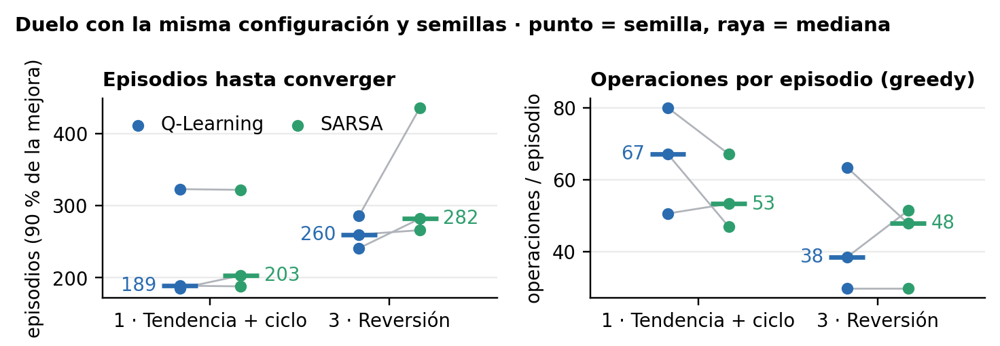
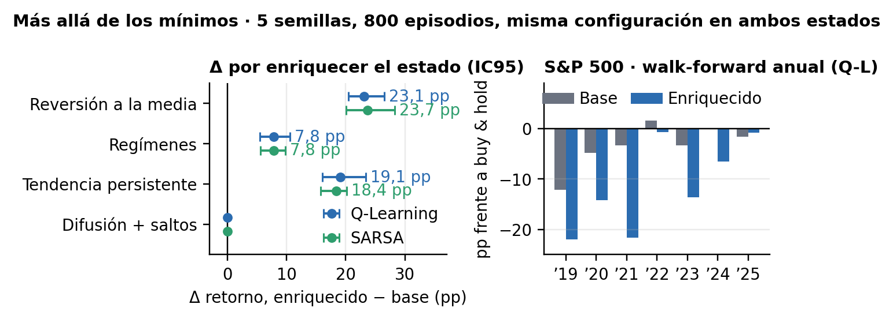

<!-- Fuente del informe (D-3.1). Cifras de results/*.csv y notebooks/04_comparativa.ipynb.
     PDF: python build_informe.py --png -->

# Agentes de RL tabular para trading de un activo

[Nombres del grupo] · Máster MIAX · Aprendizaje por Refuerzo · Octubre 2026

## 0. Planteamiento y diseño

Entorno del taller (vender, mantener, comprar; comisión 0,1 %; recompensa = retorno del paso con el activo) en cuatro mercados sintéticos: tendencia + ciclo, browniano, reversión a la media y regímenes.

- **Estado (D-1.1):** 10 bins de tendencia por cuantiles × posición = 20 estados. Se adaptan a cada mercado; con bordes fijos, el mercado 1 deja el 89 % de pasos en los extremos.
- **Protocolo (D-0.1, D-0.4):** serie nueva por episodio; 100 de validación eligen hiperparámetros; 200 de test, usadas una vez y con política greedy.
- **Métrica (D-0.3):** mediana en test (y de 5 semillas), porque en el mercado 1 buy & hold da media x200 con std de 657 veces el capital.
- **Ajuste (D-2.3):** α → γ → ε → episodios; un cambio solo entra si gana en la mayoría de semillas.

## 1. ¿Aprende la estrategia esperada?

Sí, en los cuatro mercados, y Q-Learning y SARSA aprenden la misma. Todo se mide en 200 series de test, con hiperparámetros elegidos en validación.

**1 · Tendencia + ciclo** Esperada: seguir la tendencia → aprendida: la sigue (x502).

**2 · Browniano** Esperada: no hay señal → aprendida: no opera (0 %).

**3 · Reversión a la media** Esperada: comprar caídas, vender subidas → aprendida: eso (+27,0 %).

**4 · Regímenes** Esperada: estado ciego al régimen → aprendida: no opera (0 %).

{: style="width:76%; margin:0 auto"}

Figura 1. Mediana del retorno en las 200 series de test. Agentes con hiperparámetros elegidos en validación; mediana de 5 semillas (marcas: cada semilla). Mercado 1 en múltiplo del capital, escala log.

| Mercado | Aleatorio | Buy & hold | **Q-Learning** | **SARSA** | Ops./ep. Q-L · SARSA | Conv. Q-L · SARSA (ep.) | Q-L enriq. (03) | Política aprendida |
|:--|--:|--:|--:|--:|--:|--:|--:|:--|
| 1 · Tendencia + ciclo | x4,3 | x33,6 | **x502** | **x472** | 48 · 57 | 189 · 203 | x412 | Sigue la tendencia |
| 2 · Browniano | −19,4 % | −3,5 % | **0 %** | **0 %** | 0 · 0 | — | 0 % | No opera: no hay señal |
| 3 · Reversión | −17,2 % | −0,3 % | **+27,0&nbsp;%** | **+27,0&nbsp;%** | 29 · 29 | 260 · 282 | +42,8 % | Compra tras caídas, vende tras subidas |
| 4 · Regímenes | −22,0 % | −12,5 % | **0 %** | **0 %** | 0 · 0 | — | +7,8 % | No opera: el estado no ve el régimen |

Mediana del retorno en test (mercado 1 en múltiplo del capital); agentes: mediana de 5 semillas. Ops./ep.: política greedy en test, con los hiperparámetros de cada algoritmo. Convergencia: duelo a configuración idéntica, 3 semillas (D-2.5). La columna enriquecido usa la configuración fija del 03 (800 episodios, sin ajuste; D-1.2): no es comparable uno a uno.

**Lectura.** Es la estrategia esperada porque cada política reproduce el mecanismo del generador: en el mercado 1 multiplica por ≈ 15 el capital de buy & hold; en reversión le saca +27,3 pp. No operar es correcto: el browniano no tiene señal y, en regímenes, de 70 reglas fijas sobre el estado la mejor da −8,6 % en validación, lejos del 0 % (D-2.4).

Sí: los dos algoritmos aprenden la estrategia esperada y baten a los dos baselines en los cuatro mercados.

## 2. ¿Q-Learning o SARSA?

- **Hiperparámetros.** α pequeño: 0,001 (Q-Learning) y 0,0005 (SARSA, mercados 1 y 3). Con α = 0,1 se hunden en validación (x14 y x19, mercado 1). γ = 0 en el mercado 1, donde SARSA necesita 1 000 episodios.
- **Convergencia (duelo).** Q-Learning llega antes en mediana: 189 frente a 203 episodios (mercado 1) y 260 frente a 282 (reversión). En reversión gana en 3 de 3 semillas; en el mercado 1, en una sola.
- **Misma política.** 20 estados, ε baja a 0,01 y un error cuesta un 0,1 %: no hay «acantilado».
- **Cuándo difieren.** Con ε mínimo 0,05, SARSA es más conservador (reversión: 32 → 22 operaciones). En el duelo opera menos en el mercado 1 (53 frente a 67; 2 de 3 semillas); en reversión no hay patrón (48 frente a 38 en mediana, 1 de 3 semillas).

{: style="width:76%; margin:0 auto"}

Figura 2. Duelo Q-Learning–SARSA en los mercados 1 y 3 con la misma configuración (α 0,001, γ 0,9, ε 0,99 / 0,01, 1 000 episodios) y las mismas 3 semillas: episodios hasta alcanzar el 90 % de la mejora de la recompensa (media móvil 50) y operaciones por episodio de la política greedy en validación. Punto = semilla; raya = mediana; la línea gris une la misma semilla.

Q-Learning converge algo antes, pero los dos aprenden la misma estrategia: pesan más el estado y los hiperparámetros que el algoritmo.

## 3. ¿Qué hay más allá?

Probamos estado enriquecido (MA30 + volatilidad, 180 celdas), dos mercados extra, S&P 500 real y anexo de robustez. Configuración fija (800 episodios): no comparable 1 a 1 con §1.

{: style="width:76%; margin:0 auto"}

Figura 3. Izquierda: mediana de la diferencia emparejada enriquecido − base por historia, con IC95 bootstrap. Derecha: S&amp;P 500, retorno de cada año de test menos buy &amp; hold (walk-forward anual, Q-Learning).

- **Estado:** mejora donde hay memoria. Con Q-Learning: +23,1 pp en reversión, +19,1 pp en tendencia persistente y +7,8 pp en regímenes (IC95 > 0).
- **Indicador:** basta uno por mercado. MA30 en reversión y tendencia; volatilidad en regímenes (+8,5 % frente a 0 %).
- **Mercados extra:** en tendencia persistente, base +104,5 % y enriquecido +123,8 %, frente a +22,8 % de buy & hold. En saltos no opera (0&nbsp;% frente a −22,4&nbsp;%).
- **S&P 500:** base iguala a buy & hold con 1 operación (+45,9 % frente a +44,2 %). El enriquecido baja a +28,3 %. Walk-forward 2019–2025: sin ventaja.
- **Robustez:** placebos sin ventaja falsa. ×4 episodios, otros algoritmos TD o recompensa log apenas cambian. Comisión: reversión aguanta el 0,5 % (+23,0 %); regímenes cae a 0 % con 0,25 %.

Lo que decide es la información del estado, no el algoritmo; en el índice real no hay ventaja sobre buy & hold.

## 4. Límites y qué haríamos con más tiempo

### Límites

- **Estado de 20 celdas no markoviano.** La tendencia de 6 precios no identifica el régimen.
- **La recompensa suma; el balance compone.** Con log(balance): x412 → x431 (03 §9.6).
- **Fin de episodio = límite de tiempo** (D-2.1): 1 de 494 decisiones.
- **"Q-Learning converge antes" es débil:** 3 semillas; en el mercado 1 gana 1 de 3.
- **Un solo recorrido real, sin dividendos ni spread** (D-0.5). Comparaciones sin corregir; indicadores elegidos conociendo los generadores.

### Con más tiempo

- Indicadores elegidos en validación y aproximación de funciones.
- Entrenar con mezcla de generadores (el «reto mayor» propuesto en clase).
- Más semillas en el duelo; convergencia sobre la política greedy en validación.
- Dividendos y spread; corrección de Holm por comparaciones múltiples.

La práctica cumple los mínimos: los dos algoritmos aprenden la estrategia esperada, y el límite está en el estado.

