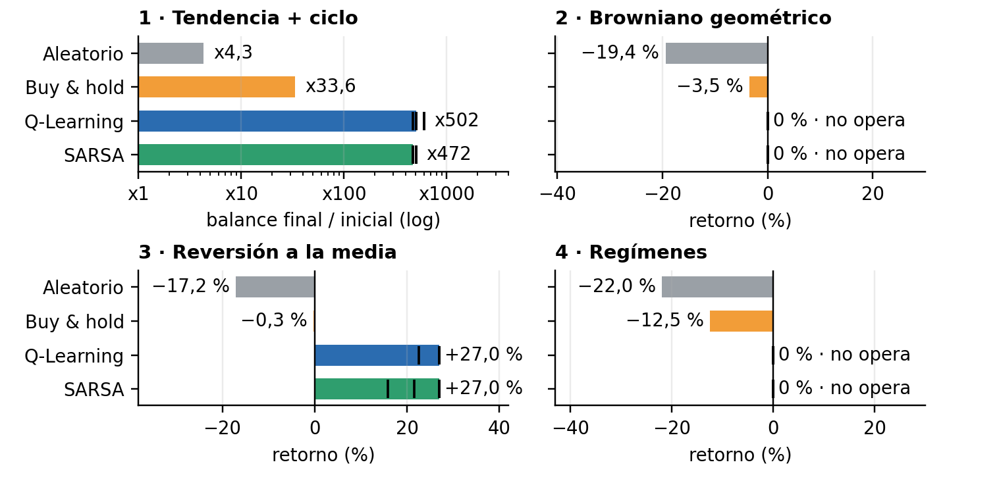
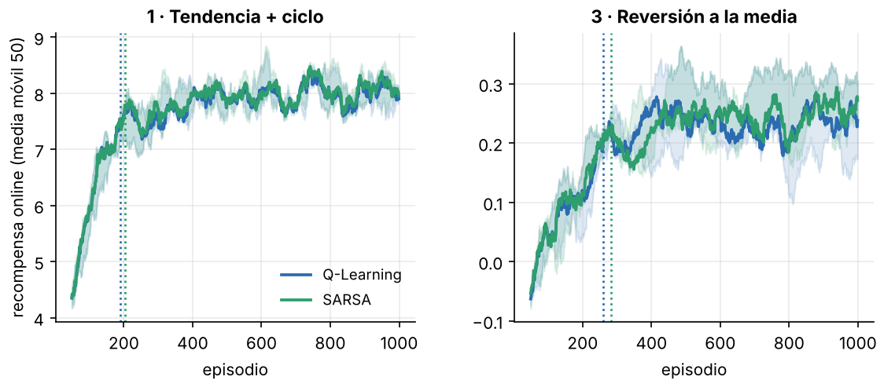
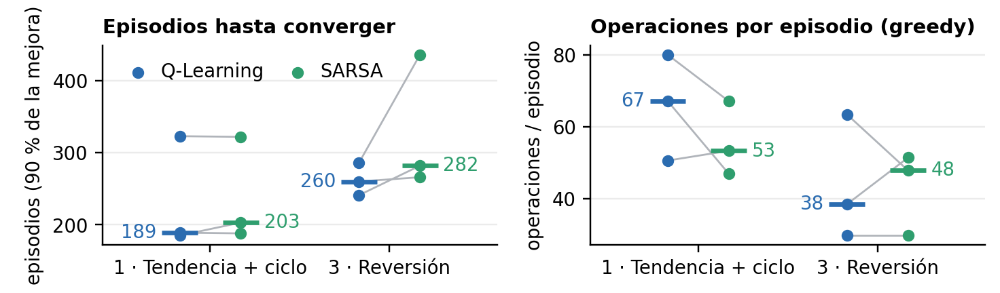
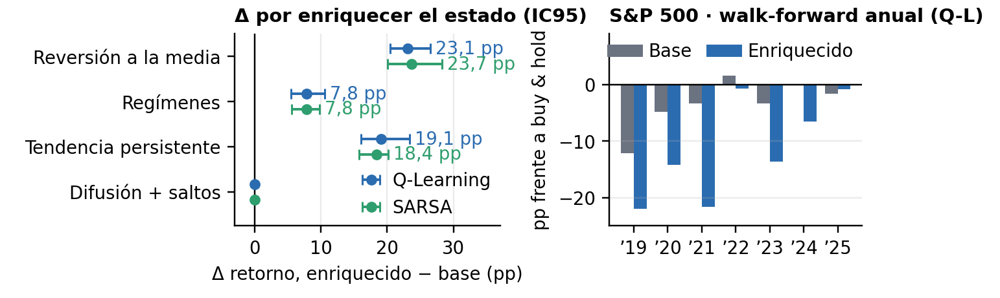

<!-- Fuente del informe (D-3.1). Cifras de results/*.csv y notebooks/04_comparativa.ipynb.
     PDF: python build_informe.py --png -->

# Agentes de RL tabular para trading de un activo

Óscar Romero Quincoces · Fernando Dapena Tauste · Daniel García López · Máster MIAX · Aprendizaje por Refuerzo · Octubre 2026

## 1. Planteamiento y diseño experimental

Trabajamos con el entorno del taller: tres acciones (vender, mantener y comprar), una comisión del 0,1&nbsp;% por operación y, como recompensa, el retorno del paso mientras se tiene el activo, con 494 decisiones por episodio. Lo evaluamos en los cuatro mercados sintéticos del enunciado (tendencia con ciclo, browniano, reversión a la media y regímenes).
El estado combina la posición con **10 bins de tendencia definidos por cuantiles**, lo que da 20 estados. Los cuantiles se calculan en cada mercado porque con bordes fijos el mercado 1 deja el 89&nbsp;% de los pasos en los bins extremos; con cuantiles, en 800 episodios cada celda se visita unas 19&nbsp;400 veces (D-1.1). Cada episodio usa una serie nueva. Elegimos los hiperparámetros con 100 series de validación y medimos el resultado una sola vez, con la política *greedy*, sobre otras 200 de test (D-0.1, D-0.4). La validación sale algo optimista (en reversión, +34,0&nbsp;% frente al +27,0&nbsp;% de test). El ajuste sigue el orden α, γ, ε (decaimiento por episodio y mínimo) y número de episodios, con 3 semillas, y solo aceptamos un cambio si mejora en la mayoría de ellas (D-2.3).

La métrica principal es la **mediana en test** (para los agentes, mediana de 5 semillas), porque la media no es representativa: en el mercado 1, buy & hold tiene una media de x200 con una desviación típica de 657 veces el capital. También miramos el Sharpe por paso, la caída máxima y el número de operaciones. Decimos que un agente ha convergido en el primer episodio en que la media móvil de 50 episodios de la recompensa alcanza el 90&nbsp;% de su mejora total (D-0.3).

## 2. Estrategia aprendida en cada mercado

En los cuatro mercados Q&#8209;Learning y SARSA **aprenden la estrategia que cabe esperar del generador de precios, y llegan a la misma** (Figura 1 y Tabla 1). A la derecha de la figura resumimos la política *greedy* por bin de tendencia (el 1 es la caída más fuerte) que elige la mayoría de las 5 semillas.

<b>Figura 1.</b> Mediana del retorno en las 200 series de test; para los agentes, mediana de 5 semillas (las marcas indican cada semilla). El mercado 1 se expresa en múltiplo del capital y en escala logarítmica.

*Ten&shy;dencia con ciclo.* El agente sigue la ten&shy;dencia: compra en los bins 7 a 10 (SARSA ya desde el 6), vende en los bins 1 a 3 y mantiene la posición en los inter&shy;me&shy;dios. Termina en x502, frente a x33,6 de buy & hold.

*Brow&shy;niano.* No hay señal que explotar y el agente no entra en ningún bin (0&nbsp;%), que es lo razo&shy;nable.

*Rever&shy;sión a la media.* Conviene comprar tras las caídas y vender tras las subidas, pero el agente solo lo hace en los extremos: compra en el bin 1 y vende en el 10 (+27,0&nbsp;%).

*Regí&shy;menes.* Habría que estar dentro en el régimen alcista y fuera en el bajista, pero con este estado no se dis&shy;tin&shy;guen y el agente no entra nunca (0&nbsp;%).

<b>Tabla 1.</b> Mediana del retorno en test (mercado 1 en múltiplo del capital); para los agentes, mediana de 5 semillas. Las operaciones por episodio corresponden a la política <i>greedy</i> en test con los hiperparámetros de cada algoritmo. La convergencia procede del duelo con configuración idéntica y 3 semillas (D-2.5); en los mercados 2 y 4 no se define porque el agente no opera. La caída máxima es la media en test. La última columna usa la configuración fija del anexo (800 episodios, sin ajuste; D-1.2) y no es comparable uno a uno con las demás.

| Mercado | Aleatorio | Buy & hold | Q&#8209;Learning | SARSA | Operaciones/ep. Q&#8209;L / SARSA | Convergencia (ep.) Q&#8209;L / SARSA | Caída máxima B&H / Q&#8209;L | Q&#8209;L con estado enriquecido |
|:--|--:|--:|--:|--:|--:|--:|--:|--:|
| 1. Tendencia con ciclo | x4,3 | x33,6 | x502 | x472 | 48 / 57 | 189 / 203 | 90&nbsp;% / 64&nbsp;% | x412 |
| 2. Browniano | −19,4&nbsp;% | −3,5&nbsp;% | 0&nbsp;% | 0&nbsp;% | 0 / 0 | — | 41&nbsp;% / 0&nbsp;% | 0&nbsp;% |
| 3. Reversión a la media | −17,2&nbsp;% | −0,3&nbsp;% | +27,0&nbsp;% | +27,0&nbsp;% | 29 / 29 | 260 / 282 | 26&nbsp;% / 20&nbsp;% | +42,8&nbsp;% |
| 4. Regímenes | −22,0&nbsp;% | −12,5&nbsp;% | 0&nbsp;% | 0&nbsp;% | 0 / 0 | — | 45&nbsp;% / 0&nbsp;% | +7,8&nbsp;% |

Decimos que es la estrategia esperada porque cada política reproduce el mecanismo que genera los precios. En el mercado 1 el agente **multiplica por unas 15 veces el capital final de buy & hold**, con un Sharpe por paso mayor (0,19 frente a 0,11) y una caída máxima menor. En reversión **supera a buy & hold en 27,3 pp**; en media y desviación típica, +28,6&nbsp;% ± 23,2&nbsp;% frente a +0,2&nbsp;% ± 7,1&nbsp;%. En los otros dos mercados **no operar también es lo correcto**: el browniano no tiene señal y, en regímenes, la mejor de 70 reglas fijas sobre el estado obtiene −8,6&nbsp;% en validación, bastante peor que quedarse fuera (D-2.4). Así, los dos algoritmos quedan por encima de ambos baselines en los cuatro mercados.

## 3. Q&#8209;Learning frente a SARSA

Los hiperparámetros elegidos en validación son parecidos. Q&#8209;Learning usa α&nbsp;=&nbsp;0,001 en los cuatro mercados, con γ&nbsp;=&nbsp;0 y ε de 0,98&nbsp;/&nbsp;0,05 (decaimiento&nbsp;/&nbsp;mínimo) en el mercado 1 y γ&nbsp;=&nbsp;0,5 en reversión. SARSA prefiere α&nbsp;=&nbsp;0,0005 y ε de 0,99&nbsp;/&nbsp;0,01 en los mercados 1 y 3, con γ&nbsp;=&nbsp;0 y 1&nbsp;000 episodios en el primero y γ&nbsp;=&nbsp;0,9 en el segundo. En los mercados 2 y 4 dejamos los valores de partida (α&nbsp;=&nbsp;0,001, γ&nbsp;=&nbsp;0,9, ε de 0,99&nbsp;/&nbsp;0,01 y 500 episodios), porque ningún cambio los hace operar. La ventaja por paso, de alrededor del 0,1&nbsp;%, es menor que el ruido que introduce un α grande, y con α&nbsp;=&nbsp;0,1 los agentes se quedan en x14 y x19 en validación. Con un ruido del 10&nbsp;% por paso, el valor del futuro lejano se estima mal y sale ganando el agente *miope* (γ&nbsp;=&nbsp;0), salvo en reversión, donde el rebote tarda varios pasos en llegar y con γ&nbsp;=&nbsp;0 el agente no opera.

Para comparar la velocidad de aprendizaje enfrentamos los dos algoritmos con la misma configuración y las mismas semillas (Figuras 2 y 3). **Q&#8209;Learning converge antes en mediana**, en 189 episodios frente a 203 en el mercado 1 y en 260 frente a 282 en reversión. En reversión es más rápido en las 3 semillas, pero en el mercado 1 solo en una, así que allí lo tratamos como un empate. Con los hiperparámetros propios de cada algoritmo la distancia crece (107 frente a 200 y 262 frente a 356), aunque entonces cambian a la vez α, γ y ε. Creemos que se debe a que el objetivo de Q&#8209;Learning usa el máximo y apunta desde el principio a la política *greedy*, mientras que SARSA estima el valor de una política *ε-greedy* cuya ε va bajando: su objetivo se mueve y es más ruidoso, porque depende de la acción muestreada, y eso encaja con que prefiera un α menor. El coste por episodio es prácticamente el mismo (unos 19 s por cada 1&nbsp;000), así que el tiempo de cómputo solo cambia con el número de episodios.

Que los dos acaben en la misma política tiene explicación. Con 20 estados y 3 acciones hay pocas políticas *greedy* posibles, y hacia el episodio 460 ε ya vale 0,01, con lo que Q(S′,&nbsp;A′) es casi igual a máx&nbsp;Q(S′,&nbsp;a). Tampoco hay un acantilado que castigue explorar: un error cuesta un 0,1&nbsp;%. Varias semillas de los dos algoritmos dan exactamente la misma tabla. En el mercado 1, las 10 semillas producen solo tres resultados: x472 y x502 con ambos algoritmos, y x605 en dos semillas de Q&#8209;Learning. La diferencia entre x502 y x472 de la Tabla 1 refleja **cuántas semillas caen en cada política, no que un algoritmo sea mejor**. Las diferencias aparecen cuando se explora más: con un ε mínimo de 0,05, SARSA es más conservador y en reversión pasa de 32 a 22 operaciones. En el duelo opera menos en el mercado 1 (53 frente a 67 operaciones, en 2 de 3 semillas), mientras que en reversión no se observa un patrón claro (48 frente a 38 en mediana, 1 de 3 semillas). Q&#8209;Learning converge algo antes, pero el resultado final **depende mucho más del estado y de los hiperparámetros que de elegir uno u otro**.

<b>Figura 2.</b> Recom&shy;pensa durante el entre&shy;na&shy;miento del duelo, con el mercado 1 a la izquierda y el 3 a la derecha, en media móvil de 50 epi&shy;so&shy;dios. La línea es la mediana de 3 semillas, la banda va del mínimo al máximo y la vertical punteada marca el episodio de con&shy;ver&shy;gencia. No mos&shy;tramos los mercados 2 y 4: allí la curva sube solo porque, al bajar ε, el agente deja de pagar comi&shy;siones por acciones alea&shy;to&shy;rias, y eso no es apren&shy;di&shy;zaje.

<b>Figura 3.</b> Duelo en los mercados 1 y 3 con la misma con&shy;fi&shy;gu&shy;ra&shy;ción (α&nbsp;=&nbsp;0,001, γ&nbsp;=&nbsp;0,9, ε de 0,99&nbsp;/&nbsp;0,01, 1&nbsp;000 epi&shy;so&shy;dios) y las mismas 3 semillas, y por tanto las mismas series de entre&shy;na&shy;miento; solo cambia el objetivo TD. A la izquierda, epi&shy;so&shy;dios hasta con&shy;verger; a la derecha, ope&shy;ra&shy;ciones por episodio de la política <i>greedy</i> en vali&shy;da&shy;ción. Cada punto es una semilla, la raya hori&shy;zontal es la mediana y la línea gris une los resul&shy;tados de una misma semilla.

## 4. Extensiones: estado enriquecido, otros mercados y S&P 500

Fuera de los mínimos probamos un estado enriquecido con la media móvil de 30 periodos (MA30) y la volatilidad (180 celdas), dos mercados sintéticos adicionales, datos reales del S&P 500 y un anexo de robustez. Aquí usamos una configuración fija de 800 episodios, por lo que las cifras no se comparan una a una con las de la sección 2.

<b>Figura 4.</b> Izquierda: mediana, por historia, de la dife&shy;rencia empa&shy;re&shy;jada entre el estado enri&shy;que&shy;cido y el base, con inter&shy;valo de con&shy;fianza boots&shy;trap del 95&nbsp;%; 5 semillas y la misma con&shy;fi&shy;gu&shy;ra&shy;ción en los dos estados. Derecha: retorno de cada año de test en el S&amp;P 500 menos el de buy &amp; hold (<i>walk-forward</i> anual, Q&#8209;Learning).

El estado enri&shy;que&shy;cido **mejora donde el precio tiene memoria** (Figura 4, izquierda): con Q&#8209;Learning gana 23,1 pp en rever&shy;sión, 19,1 pp en ten&shy;dencia per&shy;sis&shy;tente y 7,8 pp en regí&shy;menes, y en los tres el IC95 queda por encima de cero.

Probando los indicadores por separado, **casi toda la mejora viene de uno por mercado**: la MA30 en reversión y en tendencia, y la volatilidad en regímenes, donde por sí sola da un +8,5&nbsp;% frente al 0&nbsp;% del estado base. En los mercados adicionales, con tendencia persistente el estado base obtiene +104,5&nbsp;% y el enriquecido +123,8&nbsp;%, frente al +22,8&nbsp;% de buy & hold; con difusión y saltos no opera (0&nbsp;% frente a −22,4&nbsp;%).

En el S&P 500 el estado base iguala a buy & hold con una sola operación (+45,9&nbsp;% frente a +44,2&nbsp;%), mientras que el enriquecido baja a +28,3&nbsp;%, y en el *walk-forward* anual de 2019 a 2025 (Figura 4, derecha) tampoco encontramos ventaja. En el anexo de robustez, los *placebos* no producen ventajas falsas, y ni multiplicar por cuatro los episodios ni cambiar de algoritmo TD (Expected SARSA, Double Q&#8209;Learning) o pasar a una recompensa logarítmica mueven mucho los resultados. Lo que sí pesa es **la comisión**: la estrategia de reversión aguanta una comisión del 0,5&nbsp;% (+23,0&nbsp;%), mientras que en regímenes la ganancia desaparece (0&nbsp;%) ya con un 0,25&nbsp;%. De todo ello sacamos que **lo decisivo es la información que recibe el agente**, y que **en el índice real no conseguimos mejorar a buy & hold**.

## 5. Limitaciones y trabajo futuro

El estado de 20 celdas **no es mar&shy;ko&shy;viano**: la ten&shy;dencia cal&shy;cu&shy;lada con 6 precios no iden&shy;ti&shy;fica el régimen ni la dis&shy;tancia a la media. La recom&shy;pensa suma retornos mientras que el balance se compone; con log(balance) como recom&shy;pensa, el estado enri&shy;que&shy;cido pasa en el mercado 1 de x412 a x431 (notebook 03, §9.6). El mercado 1 es muy disperso (la des&shy;via&shy;ción típica de Q&#8209;Learning en test dobla su media), y por eso usamos la mediana. El fin de episodio lo tratamos como límite de tiempo, lo que afecta a 1 de cada 494 deci&shy;siones (D-2.1). La afir&shy;ma&shy;ción de que Q&#8209;Learning converge antes **es débil**, porque se basa en 3 semillas y en el mercado 1 solo gana en una. Solo tenemos un reco&shy;rrido real, sin divi&shy;dendos ni *spread* (D-0.5), no hemos corre&shy;gido por com&shy;pa&shy;ra&shy;ciones múl&shy;ti&shy;ples y los indi&shy;ca&shy;dores se eli&shy;gieron cono&shy;ciendo los gene&shy;ra&shy;dores.

Con más tiempo pasa&shy;ríamos a usar apro&shy;xi&shy;ma&shy;ción de fun&shy;ciones y ele&shy;gi&shy;ríamos los indi&shy;ca&shy;dores en vali&shy;da&shy;ción, ya que con 180 celdas cada una se visita solo entre 800 y 1&nbsp;760 veces (mediana en los mercados sin&shy;té&shy;ticos), frente a unas 19&nbsp;400 con 20. También nos interesa medir la gene&shy;ra&shy;li&shy;za&shy;ción fuera de dis&shy;tri&shy;bu&shy;ción, entre&shy;nando en un mercado y eva&shy;luando en los otros tres (una matriz 4 × 4), y entrenar con una mezcla de gene&shy;ra&shy;dores, que es el reto mayor pro&shy;puesto en clase. En el duelo usa&shy;ríamos más semillas, medi&shy;ríamos la con&shy;ver&shy;gencia sobre la política *greedy* en vali&shy;da&shy;ción e inclui&shy;ríamos divi&shy;dendos, *spread* y la correc&shy;ción de Holm para com&shy;pa&shy;ra&shy;ciones múl&shy;ti&shy;ples.

Con todo, **damos por cubiertos los mínimos**: los dos algo&shy;ritmos aprenden la estra&shy;tegia de cada generador. Código y resultados en <a href="https://github.com/Romequinco/rl-trading-agents" style="color:inherit">github.com/Romequinco/rl-trading-agents</a>.

